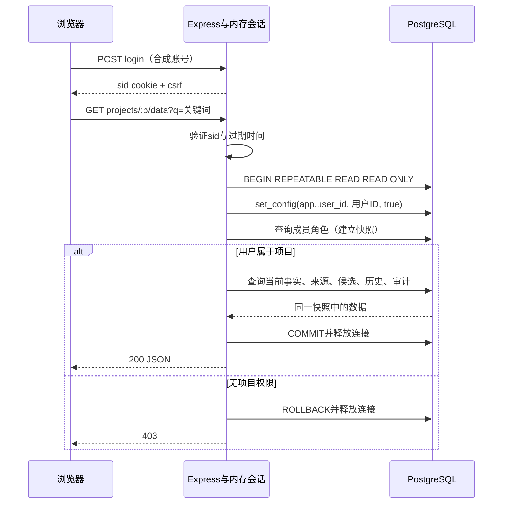
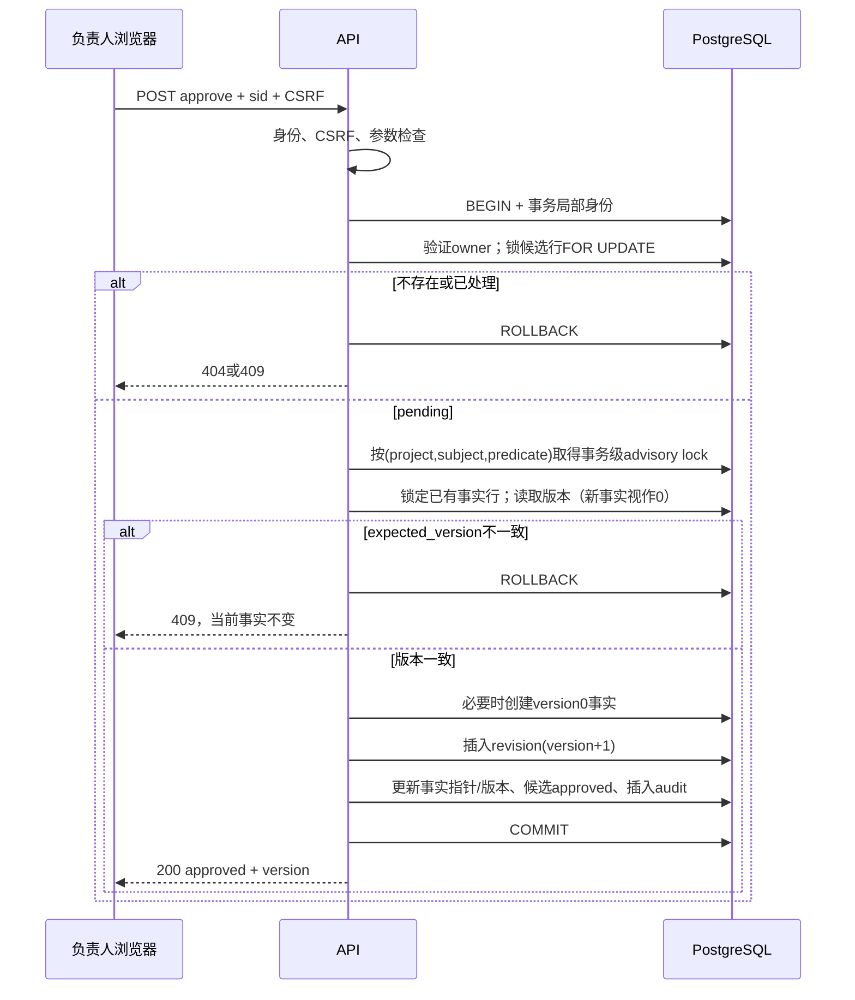

# 接口与事务时序

实现依据：`server.js`。本机默认地址 `http://127.0.0.1:3000`，JSON请求体上限16 KiB。除登录外，API 需要服务端随机 `sid` cookie；非 GET/HEAD 还需 `X-CSRF-Token`。身份取自会话，不接受请求中的 user_id/role 指定。成功响应均为200，未采用201状态。

## 接口清单

| 方法与路径 | 输入 | 成功结果 | 权限与主要失败 |
| --- | --- | --- | --- |
| POST /api/login | username, password | name, csrf；设置sid cookie | 公开合成账号；用户名/密码须为字符串，错误凭据401；不匹配的Origin返回403 JSON |
| GET /api/me | cookie | name, csrf | 未登录/过期401 |
| POST /api/logout | cookie、CSRF；无请求体也可 | ok:true；清除会话/cookie | 未登录401；CSRF错误403 |
| GET /api/projects | cookie | id/name/role 数组 | 仅当前用户所属项目 |
| GET /api/projects/:p/data?q= | 项目ID、可选q | role,facts,sources,candidates,history,audit | 项目成员；跨项目403 |
| POST /api/projects/:p/sources | title,content | 新来源完整行 | owner/member；字段不合法400；无权限403 |
| POST /api/projects/:p/candidates | subject,predicate,value,source_id,expected_version | 新候选完整行 | owner/member；来源跨项目/无效输入400；无权限403 |
| POST /api/projects/:p/candidates/:id/approve | 路径参数；无需请求体 | status:approved,version | owner；候选不存在404；已处理/版本冲突409 |
| POST /api/projects/:p/candidates/:id/reject | 路径参数；无需请求体 | status:rejected | owner；不存在404；已处理409 |

决策路径除approve/reject外返回400。ID接受正整数或十进制数字字符串；expected_version接受0至2147483647的整数或数字字符串。字符串必填、非空，trim后使用，长度在trim前校验；上限见数据字典。所有已处理API错误返回 `{error:说明}`，包括登录Origin拒绝和已认证未知API路由404。登录、来源、候选要求Content-Type为application/json（允许charset参数）：缺少或不支持的类型415；类型正确但空请求体、数组、标量或坏JSON400；超过16KiB为413；不支持的字符集/编码415。合法空对象仍由字段/凭据校验判定。审批、驳回和退出保持支持无请求体。解析错误使用固定消息，不反射输入原文，且保留安全响应头。解析器先于认证运行，坏JSON可能先被拒绝；其他业务写请求先经过会话与CSRF门禁。断开的传输连接不保证还能收到错误正文。

q是单个字符串时截取前200个 UTF-16 code units，否则当空串。检索不trim q；空串匹配全部当前事实。仅过滤facts的主体、属性和值，其他返回数组不按q过滤。facts按ID升序；候选/历史按ID降序；审计按ID降序最多100条；没有分页。

### 候选请求示例

```json
{"subject":"项目","predicate":"截止日","value":"15号","source_id":2,"expected_version":1}
```

示例为合成演示数据；请求仍需当前会话cookie和CSRF，不能靠上述JSON伪造身份。成功提交仅产生pending候选与propose审计，不更新当前事实。

## 创建重试

来源/候选POST可携带Idempotency-Key；按项目、用户、接口隔离，同键同规范化内容返回原创建响应，同键异内容409，键不合法400。无键保持每次创建的旧行为。权限检查先于重放，回执与业务/审计同事务，详见[idempotent-creation.md](idempotent-creation.md)。

## 登录与读取



快照测试在事实读取与后续读取之间提交另一个审批，验证同一个响应不混合新旧候选/历史。事务局部身份结束后不留在连接池中；无身份的应用数据库查询受RLS限制。

## 审批与冲突



候选行锁避免重复审批；事实键advisory lock连首次创建也覆盖，避免两个候选都以版本0创建相同事实。不同事实键的哈希碰撞只增加串行等待。任何步骤失败回滚全部业务变更；序列编号可能有间隙，不应把间隙当作丢失历史。

驳回在取得候选行锁并确认pending后，更新状态为rejected并插入reject审计，再提交；不取得事实键锁、不检查expected_version，也不生成修订。失败路径由集成测试与浏览器冲突/驳回截图佐证。

## 当前范围与后续缺口

这是本机演示API：内存会话、无真实用户注册、仅来源/候选支持可选幂等键、无列表分页、无通用结构化审计查询。网络层重试已成功的审批会得到409，不重复生成修订；客户端需重新读取状态判断。不要把这些限制写成已实现功能。已补JSON对象及错误响应校验；后续应根据受控测量优化响应规模，并管理创建回执增长与客户端跨刷新重试限制。

## 只读取当前事实

`GET /api/projects/:p/facts` 是可选的游标分页读取：校验参数 → 只读事务身份与角色 → 当前修订查询 limit+1 → 提交 → 返回 role/facts/next_after。单页一致、多页不是同一快照；详见[接口契约及测量](bounded-retrieval.md)。原聚合读取时序保持不变。
