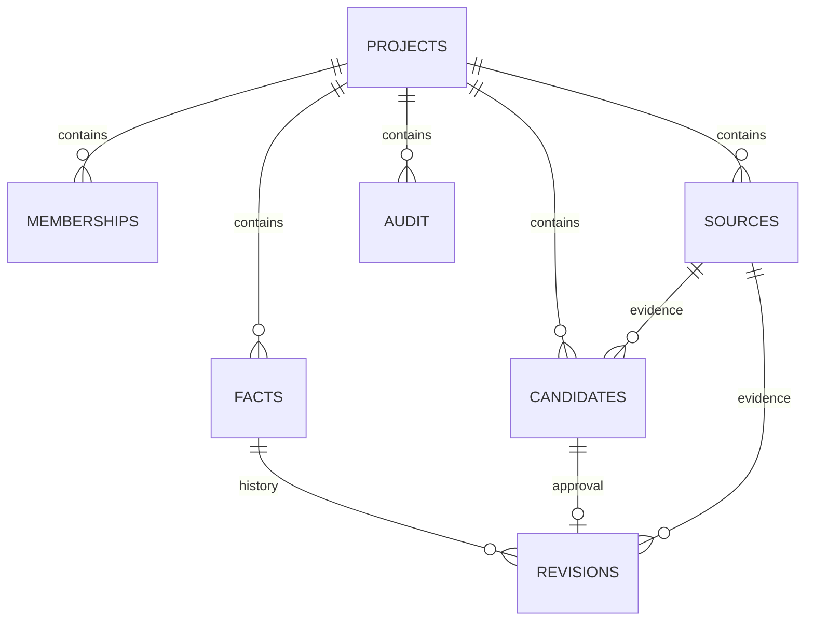

# 数据模型与设计取舍

## 需求与功能

项目成员提交带来源的结构化事实候选，负责人批准或驳回。批准必须基于提交时的当前版本；过期候选返回 409，不覆盖。只读者能浏览，不能写入。当前检索只查已批准的当前修订；历史、待审、驳回均不混入。每项内容显示来源，操作记录可回看。外部文本是数据，不能作为系统指令执行。演示客户端只构造固定请求，不是语言模型。

## 关系

`facts` 的 `(project_id, subject, predicate)` 唯一；revision 按事实版本唯一，candidate 至多关联一条 revision。来源、候选和修订通过包含 project_id 的复合外键约束同项目；修订无应用角色 UPDATE/DELETE 权限。当前指针通过 `(project_id,id,version,current_revision_id)` 复合外键绑定同一事实、同一版本的修订，禁止指向同项目的其他事实或与版本号不符的修订；CHECK 约束要求版本 0 为空指针、正版本为非空指针。版本 0 仅用于创建过程的占位，应用在同一事务内完成首次修订。当前指针、版本、候选状态和审计在同一事务内更新。候选行锁防重复审批，按事实键的事务级 advisory lock 覆盖首次创建和已有事实并发，随后检查 expected_version。哈希碰撞只会带来额外串行化，不会使不同键混同。

RLS 对所有业务表生效，以 security-definer 函数查询成员角色，避免 membership 策略递归。服务端每次从 cookie 找到会话，在事务内 `set_config(..., true)`，结束归还连接；无上下文无项目可见。权限同时在服务端和数据库策略检查。聚合读取使用只读的 REPEATABLE READ 事务，保证事实、候选、历史与审计来自同一快照；审批继续使用默认隔离级别。应用角色不是 schema owner；身份上下文不是抵御数据库凭据泄露的安全边界。

## 检验范围

`test/integration.test.js` 使用 PostgreSQL 直接验证角色属性、无上下文、连接复用、并发、回滚、重复审批、来源项目约束、伪造 HTTP 身份和关键词。浏览器脚本提供真实交互截图。尚未做负载评测、真实模型效果评测或生产级安全测试；演示效果不能当作科研结果。
