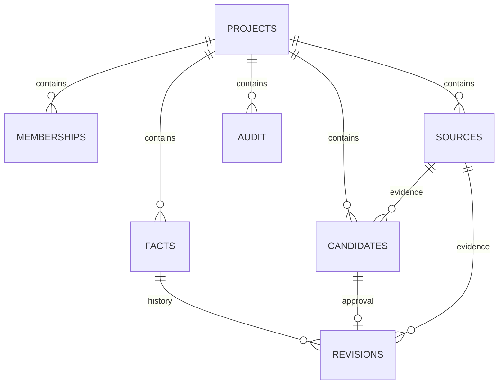
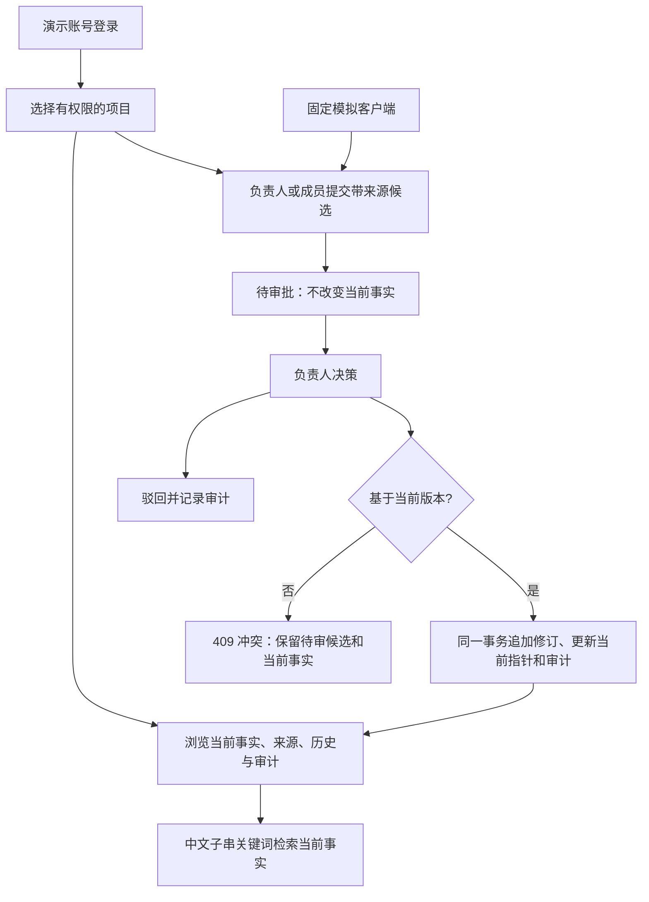
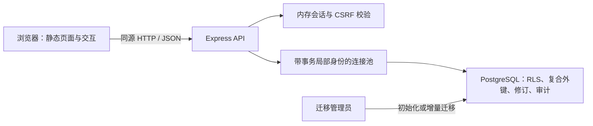

# 历史设计：项目上下文记忆

> 2026-11-09 产品转向：当前 Memz 的唯一知识领域是漏洞知识与 CVE 详情，面向 AI 智能体提供检索服务。当前设计见 [产品需求](cve-product-direction.md) 与 [检索树](cve-retrieval-tree.md)。下文保留旧原型的实现依据，不再定义产品主线。

## 需求与功能

项目成员提交带来源的结构化事实候选，负责人批准或驳回。批准必须基于提交时的当前版本；过期候选返回 409，不覆盖。只读者能浏览，不能写入。当前检索只查已批准的当前修订；历史、待审、驳回均不混入。每项内容显示来源，操作记录可回看。外部文本是数据，不能作为系统指令执行。演示客户端只构造固定请求，不是语言模型。

## 关系

`facts` 的 `(project_id, subject, predicate)` 唯一；revision 按事实版本唯一，candidate 至多关联一条 revision。来源、候选和修订通过包含 project_id 的复合外键约束同项目；修订无应用角色 UPDATE/DELETE 权限。当前指针通过 `(project_id,id,version,current_revision_id)` 复合外键绑定同一事实、同一版本的修订，禁止指向同项目的其他事实或与版本号不符的修订；CHECK 约束要求版本 0 为空指针、正版本为非空指针。版本 0 仅用于创建过程的占位，应用在同一事务内完成首次修订。当前指针、版本、候选状态和审计在同一事务内更新。候选行锁防重复审批，按事实键的事务级 advisory lock 覆盖首次创建和已有事实并发，随后检查 expected_version。哈希碰撞只会带来额外串行化，不会使不同键混同。

RLS 对所有业务表生效，以 security-definer 函数查询成员角色，避免 membership 策略递归。服务端每次从 cookie 找到会话，在事务内 `set_config(..., true)`，结束归还连接；无上下文无项目可见。权限同时在服务端和数据库策略检查。聚合读取使用只读的 REPEATABLE READ 事务，保证事实、候选、历史与审计来自同一快照；审批继续使用默认隔离级别。应用角色不是 schema owner；身份上下文不是抵御数据库凭据泄露的安全边界。

## 检验范围

`test/integration.test.js` 使用 PostgreSQL 直接验证角色属性、无上下文、连接复用、并发、回滚、重复审批、来源项目约束、伪造 HTTP 身份和关键词。浏览器脚本提供真实交互截图。尚未做负载评测、真实模型效果评测或生产级安全测试；演示效果不能当作科研结果。

新增[合成检索评测](retrieval-evaluation.md)：固定数据和 19 个期望结果用例，通过真实 HTTP 检查当前事实检索与隔离，并记录串行热身后的原始耗时样本。该小语料基线不等于负载或模型效果评测。

## 功能模型与实现边界

只读者仅能浏览和检索；成员可添加来源并提议；负责人可批准或驳回。另一项目用户只能访问其所属项目。图中的模拟客户端仅构造固定候选，没有真实模型调用。检索只过滤当前事实字段，来源、候选、历史在独立区域展示。

## 系统结构

应用连接使用 `memz_app`，管理员只执行初始化、备份和升级。聚合读取采用只读快照；审批采用行锁、事实键 advisory lock 和版本比较。服务仅监听本机 HTTP，固定公开账号与内存会话属于演示限制。测试报告通过独立临时数据库生成，不往现有演示库导入评测数据。

## 可选多关键词检索：能力改进与兼容边界

整段子串匹配要求查询按存储字段的拼接次序出现，例如种子事实“项目 / 截止日 / 20号”不能被“截止日 项目”匹配。本轮新增显式 `all_terms`，以空白分隔的字面词片段做无序 AND：每项可在 subject、predicate、当前 revision.value 的任一字段内命中。排序继续使用唯一的 fact.id 升序，不引入相关性分数，不改变原 after 位置游标；这是检索表达能力改进，没有查询加速或自然语言理解结论。

默认 substring 分支和响应形状保持兼容，新模式单独回显 terms、字段、大小写规则与排序。客户端必须验证此回执，防止旧服务忽略新参数而静默执行另一种查询。新模式输入、共享解析和 opt-in 用法详见 [lexical-retrieval.md](lexical-retrieval.md)。批准修订、来源原文、RLS、版本固定、批量溯源和预算前缀都继续使用原路径。每页单独只读快照，翻页前已越过的事实后来改变匹配状态仍可能漏过；稳定排序不是跨请求冻结结果。

没有新增索引、数据库迁移、扩展、模型或服务。[已有标题索引研究](search-index-study.md)没有证明应用角色下可获收益，不能用管理员绕过 RLS 的计划替代应用证据。多词条件的扫描工作量可能增加，最多八项的输入限制只是界限，并不是性能保证。相关性排名需要另定排序与游标，全文分析需要另定语言规则，均留待有证据时再引入。

原始技术依据（2026-11-06 核查，PostgreSQL 16）：[字符串函数](https://www.postgresql.org/docs/16/functions-string.html)定义 `position` 和受 locale 影响的 `lower`；[LIMIT 与排序](https://www.postgresql.org/docs/16/queries-limit.html)要求可预测的唯一顺序；[行安全策略](https://www.postgresql.org/docs/16/ddl-rowsecurity.html)说明应用查询的权限约束；[全文搜索介绍](https://www.postgresql.org/docs/16/textsearch-intro.html)表明语言分析、词形规范化不同于本轮字面片段匹配。本轮没有复制上游实现，也未新增论文复现成绩。

## 单页快照与来源传输

可选 `GET /api/projects/:p/context` 将角色判定、当前事实页、固定修订依据和本页所需完整来源纳入同一只读 REPEATABLE READ 事务。来源按 ID 独立读取并在 HTTP 响应中只出现一次；客户端验证版本、来源集合与协议回执后，再选择内联输出或来源字典，并执行既有完整前缀预算规则。默认 individual/batch 不改变。

现有不可变修订本来就能保证事实与依据按版本对应；新路径的增量是单页事务视图与较少的重复传输，不是修复混版或提升检索质量。每页最多25条，不自动拆成多个事务；跨页仍是新快照，读取开始后发生的批准或权限撤销也不使已建立的事务快照自动更新。来源定位导入与预算早停各有额外产品语义，本轮未混入。候选取舍、协议及验证边界见 [snapshot-context.md](snapshot-context.md)。
