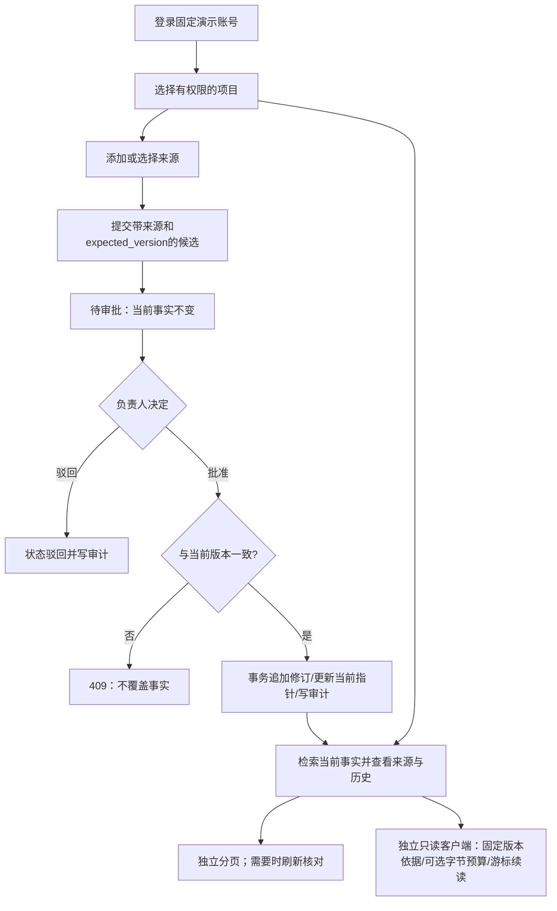

# Memz 初赛材料草稿：可审计的项目记忆

本稿按已转交核实的通知六项内容组织，并非官方模板。原通知全文尚未归档仓库，提交格式、渠道和最终排版需另行复核。本项目使用公开演示账号、合成种子和人工输入；没有真实语言模型调用，不把测试效果表述为真实用户收益或比赛成绩。正式使用时附同一提交生成的材料包、报告和CI终态。

## 一、需求分析

团队讨论中的“项目截止日”可能先是20号，随后根据更正纪要改为15号。旧客户端仍可能提议25号，来源正文也可能包含“忽略规则”等文字。系统需要区分来源材料、待审提议、已批准当前事实和历史，避免未批准内容直接进入当前记忆，同时能够说明某个值来自何处、由谁批准。

负责人可审批，成员可添加来源和提议，只读者可浏览；用户仅访问所属项目。核心验收为：来源先于提议、批准后版本递增、冲突不覆盖、旧版本保留、项目隔离、事务失败整体回滚。页面还需支持规模增长时的分页，并在跨页数据变化时保持明确提示。完整R01–R26对应表见[需求与验收](requirements-acceptance.md)。R编号是内部组织方式，不是赛事评分权重。

当前范围是单机数据库应用演示。真实账号体系、持久化会话、模型抽取、语义检索、生产部署和正式用户研究均不在已实现能力内。

## 二、功能模型图及说明

来源正文作为文本显示，不作为指令执行。模拟客户端按钮只是固定请求生成器。事实检索只查询当前修订；待审、驳回和旧值可在各自区域阅读，但不混入当前事实。审批成功或409后的列表重新加载，筛选保留；分页之间不是共同快照。功能边界与角色说明见[设计说明](design.md)。

## 三、数据库设计

| 表 | 作用与主要联系 |
|---|---|
| projects | 项目范围与名称 |
| memberships | 项目成员及owner/member/viewer角色 |
| sources | 来源标题与正文，通过项目内ID被候选和修订引用 |
| candidates | 提议值、来源、提交者、expected_version及pending/approved/rejected状态 |
| facts | 项目内唯一subject/predicate，指向当前版本修订 |
| revisions | 追加式版本、来源、候选及批准者，保留旧值 |
| audit | 项目范围的操作记录 |
| idempotency_requests | 创建请求同范围同键的内容摘要与原始响应回执 |

事实键(project_id,subject,predicate)唯一；修订按事实及版本唯一，一个候选最多对应一条修订。项目复合外键禁止跨项目引用来源或候选。当前指针复合外键同时绑定项目、事实、版本和修订，CHECK保证0版本为空指针、正版本必须有指针。应用角色不能更新或删除来源、修订及回执；来源与版本证据不由页面分页操作改变。

### 用一条事实读懂数据模型

以下S/C/F/R是说明关系的符号，不是某次测试的真实主键；实际ID以报告和界面为准。

| 时点 | 不可变证据 | 提议与当前事实 |
|---|---|---|
| 初始“20号” | 来源S1；修订R1保存20号、版本1及批准者 | 事实F的版本1指向R1 |
| 收到更正“15号” | 新来源S2，旧来源S1仍保留 | 候选C2引用S2、expected_version=1；F仍指向R1 |
| 负责人批准C2 | 追加R2，记录15号、版本2、C2和批准者 | 同一事务把F改为版本2并指向R2，C2置approved并写审计 |
| 旧客户端再提“25号” | 新提议仍可保留来源与内容 | expected_version=1与F版本2冲突，审批返回409；R2仍为当前值 |

来源回答“原文是什么”，候选回答“有人建议了什么”，修订回答“批准过什么”，事实指针回答“现在使用什么”。将它们分开，才能同时保留旧值、拒绝过期覆盖并明确当前检索范围。候选的expected_version是乐观并发条件，不是自动成为修订的版本号。

三个可验证的数据库设计点：

- 当前指针不能指向另一个事实，也不能只改版本不改修订。复合外键和CHECK在直接SQL层拒绝错误状态；迁移回归中的assertGuards检查23503和23514，不能只靠页面禁用按钮。
- 批准是一个事务。候选行锁阻止重复决定，事实键锁协调同一事实的竞争提议，版本比较拒绝旧请求；异常注入验证修订、当前值、候选与审计一起回滚。
- RLS限制项目范围，复合外键约束项目内引用。它们分别处理“能读写哪些行”和“行之间能怎样关联”，仍信任服务端身份上下文；不是对应用数据库凭据泄漏的防御。

这些是已实现机制的说明，不声称算法创新或未经测量的性能优势。代码入口与逐项验收见[关键实现](key-implementation.md)、[数据库原始取证](database-evidence.md)。

RLS按事务局部用户上下文及成员角色限制业务表。来源索引的真实计划、两种合成规模和LIMIT边界见[查询计划实验](query-plans.md)，不以索引使用或单页返回量推断生产性能。字段、类型、约束、索引和权限详情见[数据字典](data-dictionary.md)；ER图见[设计说明](design.md)。001与002是保留数据增量迁移，迁移测试覆盖旧库升级、重复/并发执行及失败回滚，不将重新初始化数据库当作升级。

## 四、系统分析与设计

浏览器静态页面通过同源Express API访问PostgreSQL。登录生成随机不透明会话cookie，写入请求检查CSRF；数据库连接为非owner、非超级用户、无BYPASSRLS的应用角色。每个事务设置局部身份，归还连接前提交或回滚，避免连接复用泄漏身份。该设计仍信任服务端设置身份，不能抵御应用数据库凭据泄漏。

审批先锁候选行，复核pending；再按项目及事实键取事务锁，读取版本并比较expected_version。修订、当前指针、候选状态和审计一起提交。并发决定只有一次成功，过期提议409；异常时整体回滚。来源/候选创建可用幂等键重放同内容原响应，异内容同键409。

聚合读取和各分页请求各自使用只读REPEATABLE READ快照。当前事实、历史、候选、来源独立分页，单页一致不等于多页或多个区域同一时间点。页面有刷新、加载/错误状态和旧响应保护；选中来源ID跨页保留，服务端提交时再次核验项目。接口时序见[接口设计](api-sequences.md)，关键实现见[代码说明](key-implementation.md)。

## 五、系统实施

主要实现为server.js、idempotency.js、db/schema.sql、db/migrations与public目录。页面实现登录、来源创建/选择、候选提议/筛选、批准/驳回、当前事实检索、历史、审计及分页。当前事实可按所显示版本查看精确原文、修订与候选ID，避免同名来源或后续审批造成错误归因；接入步骤及无模型依赖的只读Node客户端见[上下文客户端](context-client.md)，显式区分截断、固定历史依据和完成时最新值。长正文折叠、键盘焦点和状态播报经过列明用例验证，不宣称完整可访问性认证。

完整独立进程故事由scripts/demo-story.js真实执行，串联待审、批准、更正、冲突、驳回、旧依据及接入方实际JSON；同提交材料包首页提供从原始TAP提取的演示记录。初始演示步骤见[演示脚本](demo-script.md)，启动与管理员/应用连接配置见[README](../README.md)。正式材料包保留源码、设计文档、原始JSON报告及20张真实截图：01/02为登录与工作台，03为批准与历史，04为409，05/06为不可信候选与驳回，07/08为权限隔离，09–20为分页、并发状态、故障恢复和来源选择。具体图意与测试注入界限见[证据说明](demo-evidence.md)。

证据打包程序校验同一干净提交、源码SHA-256、数据库原始TAP与清理状态、20张PNG、检索用例身份/黄金值及客户端竞态结果，再生成清单和六项材料入口。它防止无意混用旧图和新代码；校验值不是数字签名，也不验证来源文本的外部真实性。

## 六、系统测试与评价

| 关注点 | 可复现验证 | 判定边界 |
|---|---|---|
| 完整接入故事 | 独立Node进程执行7个可核对阶段，保留实际JSON和来源ID | 固定合成账号与数据，无模型回答或真实用户研究 |
| 审批/冲突/回滚/隔离 | PostgreSQL HTTP与直接SQL集成、并发与异常注入 | 只证明列明状态转移和约束 |
| 备份恢复 | 自定义格式备份、损坏归档失败、恢复后逐项比对与继续写入；见[恢复演练](backup-recovery.md) | 随机合成库、停止写入后的逻辑备份；不证明PITR或灾难恢复时限 |
| 保留数据升级 | 九组迁移回归，包含新旧库幂等与14组分页子测试 | 使用随机临时库，不修改现有演示库 |
| 输入错误 | 八组请求体边界测试 | 验证400/413/415等约定与拒绝路径 |
| 检索正确性 | 19个固定合成黄金用例，旧接口及分页遍历比对 | 关键词子串检索，不是语义检索评测 |
| 来源规模 | 独立追加200/500条4000字符来源，完整遍历及JSON字节测量 | 不据此推断SQL性能、生产吞吐或用户效果 |
| 浏览器流程 | 临时库真实Chromium交互与20图；延迟、503明确注入 | 自动断言不替代全部视觉/安全评审 |
| 材料一致性 | 同提交、哈希、用例与文件集合校验；过期/篡改/失败反例 | 同时改写报告和校验值仍可伪造，需独立核对Git与CI |

系统测试入口在独立临时库执行核心测试与九组迁移回归，保存两份原始TAP、标准错误及JSON摘要；材料包的index.md直接链接这些文件，数量以该次报告为准。打包器重新解析TAP，拒绝失败、跳过、取消、待办、摘要不一致或清理未确认的结果。

实际结果以材料包内报告、manifest提交及该提交CI终态为准，不把预计通过写成实测。检索耗时为串行localhost完整响应与解析，不是单条SQL；JSON字节为未压缩响应，不含所有页面资源。规模报告详见[检索评价](retrieval-evaluation.md)及各分页说明。

现有演示可检验数据库约束、事务、RLS、版本溯源和分页一致性取舍。固定公开账号、内存会话、本机HTTP、合成语料及旧聚合全量兼容仍是限制；没有生产安全、真实智能体效果、比赛排名或未测试性能保证。
